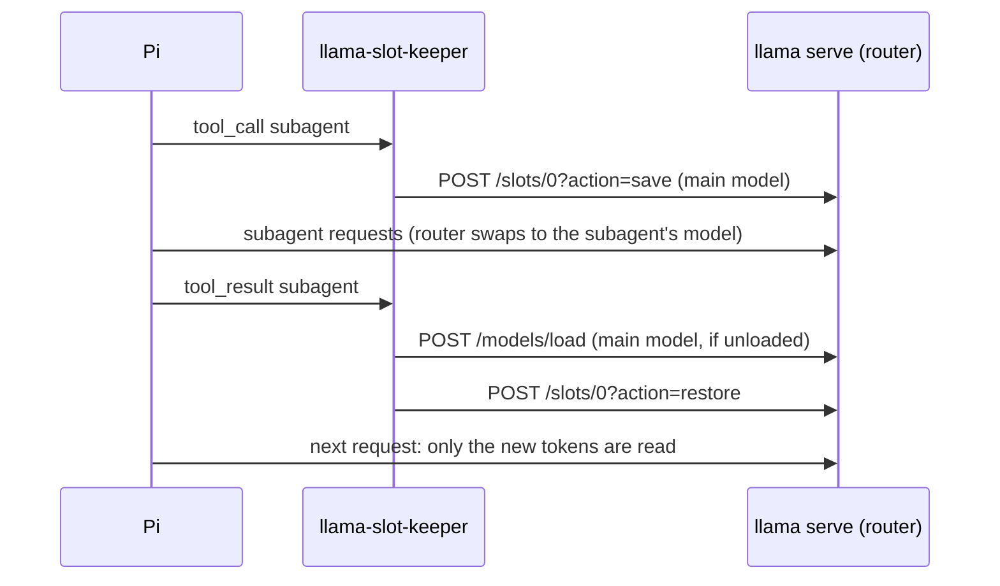

# llama-slot-keeper

A [Pi](https://pi.dev) extension that keeps the main model's llama.cpp prompt cache across subagent runs.

With `llama serve` in router mode and one model loaded at a time (`--models-max 1`), a subagent on another model
unloads the main model. When the subagent returns, the router loads the main model with an empty cache, and the main
model reads the whole conversation again before its next reply. The extension saves the main model's slot to disk when
a subagent tool starts, and restores it when the tool returns, before Pi sends the next request.



## Measured

RTX 4090 at 200 W, llama.cpp build 11574, 2026-10-15. Main model Qwen3.8-27B UD-Q4_K_XL with its MTP draft;
subagent model LFM2.5-24B-A2B UD-Q4_K_XL. Both load from the page cache: 3.5 to 3.8 s for LFM2.5, 4.3 s for Qwen.

| Main conversation | Save | Restore | Next request with the extension | Without it |
|---|---|---|---|---|
| 33,869 tokens, a delegation turn (API test) | 0.7 s, 2.1 GB | 0.7 s | 34 tokens, 0.5 s | 34,063 tokens, 28.6 s |
| 102,472 tokens (API test) | 1.6 s, 4.9 GB | 1.6 s | 37 tokens, 0.6 s | 102,509 tokens, 113.3 s |
| Pi session, 17.8k tokens, one scout on LFM2.5 | about 0.5 s | about 1 s | 311 tokens, 0.6 s | 18,474 tokens, 15.0 s |

After a restore, greedy answers matched the answers given without a swap. The saved file includes the MTP draft state
and llama.cpp's context checkpoints. Two scouts in parallel in one tool batch caused one save and one restore.

## Requirements

- A llama.cpp server started with `--slot-save-path` (`slot-save-path = <dir>` in a router preset). For Qwen3.8-27B a
  file takes about 43 KB per token plus 0.5 GB.
- The main conversation in one slot: `parallel = 1` in the main model's preset, or `PI_SLOT_KEEPER_SLOT`.
- A subagent tool, such as the `subagent` extension in Pi's
  `examples/extensions/subagent`, which runs each agent as a separate `pi` process with its own `model:`.
- A Pi provider for the server: the built-in `llama.cpp` provider (`/login llama.cpp`).

## Install

```bash
mkdir -p ~/.pi/agent/extensions
ln -s "$PWD/extensions/pi/llama-slot-keeper" ~/.pi/agent/extensions/llama-slot-keeper
```

For one run: `pi --extension extensions/pi/llama-slot-keeper/index.ts`.

A subagent agent file that runs on another preset of the same router, `~/.pi/agent/agents/scout.md`:

```markdown
---
name: scout
description: Fast codebase recon that returns compressed context for handoff to other agents
tools: read, grep, find, ls, bash
model: llama.cpp/lfm2.5-24b-a2b-agent-131k
---
```

## Settings

| Variable | Default | Meaning |
|---|---|---|
| `PI_SLOT_KEEPER_TOOLS` | `subagent` | Tools that hand work to another model, comma-separated |
| `PI_SLOT_KEEPER_PROVIDERS` | `llama.cpp` | Pi providers served by llama.cpp, comma-separated |
| `PI_SLOT_KEEPER_SLOT` | `0` | The slot that holds the main conversation |
| `PI_SLOT_KEEPER_DIR` | unset | The server's `--slot-save-path`; when set, the extension deletes the session's files at session end |

## Behaviour

- One file per session and main model, `pi-<session>-<model>.bin`, overwritten on each delegation. Without
  `PI_SLOT_KEEPER_DIR` the files stay in the server's slot directory.
- A failed save or restore never blocks the tool. Pi shows a warning, and the next request reads the whole conversation
  as it would without the extension.
- The extension saves a loaded main model only: when the router has already unloaded it, there is nothing to save.
- Untested: a single-model server, where the subagent shares the main model's slot.
